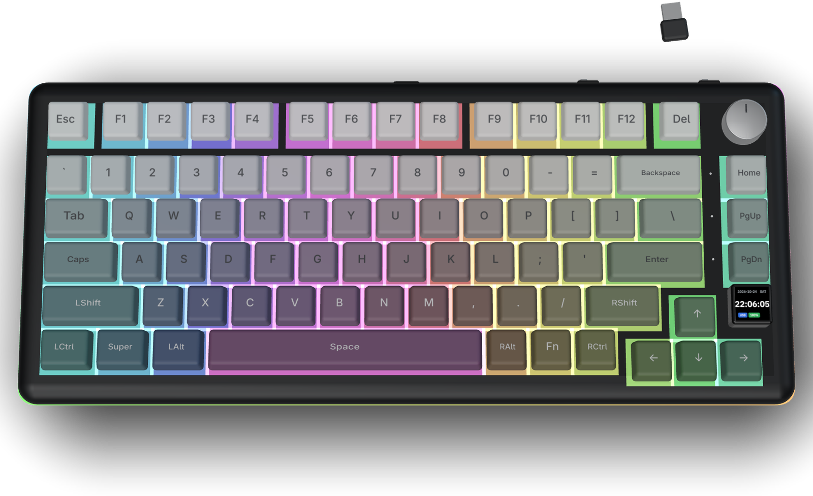
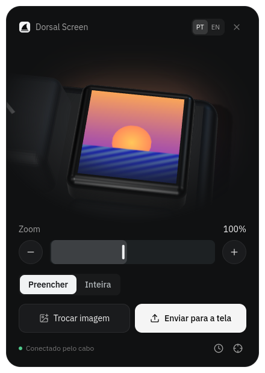

<h1 align="center">
  &nbsp;Dorsal
</h1>
<p align="center">Configurador aberto para o <strong>Attack Shark X85 Pro</strong> no Linux: tela TFT, teclas, iluminação e bateria, sem Windows e sem driver.</p>
<p align="center">
  &nbsp;
  &nbsp;
</p>
<p align="center"><a href="https://dorsal.cotoo.dev"><strong>dorsal.cotoo.dev</strong></a></p>
<p align="center"><a href="README.md">English</a> · <strong>Português</strong></p>

<br>

<p align="center"></p>

### Quick Start

```bash
# Acesso ao teclado (uma vez)
sudo cp udev/70-attack-shark-x85.rules /etc/udev/rules.d/
sudo udevadm control --reload && sudo udevadm trigger --subsystem-match=hidraw

# Instalar e abrir
npm install
npm run dev        # http://localhost:5173, no Chrome, Edge, Chromium ou Brave
```

---

### Sobre

O X85 Pro é configurado oficialmente pelo **qmk.top**, um site que fala com o teclado via WebHID, e por um executável de Windows. No Linux, nenhum dos dois funciona: o sistema só deixa o root abrir os dispositivos `hidraw`. Além disso, o firmware do X85 (ID **3451**) não está no catálogo do site, e o editor da tela nem aparece.

O **Dorsal** reimplementa o protocolo do teclado do zero, a partir de engenharia reversa para interoperabilidade, e entrega o configurador completo em três formatos com o mesmo código: um **site** que roda no navegador, um **AppImage** com janela própria e o **Dorsal Screen**, uma janela pequena só para a tela.

**Funcionalidades:**

- **Tela TFT:** envia imagens e GIFs de até 60 quadros (128 × 128, RGB565), com enquadramento por arraste e zoom, e acerta o relógio do teclado. O envio continua com a janela em segundo plano.
- **Teclas:** remapeia a camada normal e a camada segurando Fn, além do knob (apertar e girar). As teclas trocadas aparecem em destaque, com retorno ao padrão de fábrica.
- **Iluminação:** os 21 efeitos das teclas e os 5 da luz lateral, com cor, brilho e velocidade, animados no modelo 3D antes de aplicar.
- **Sistema:** taxa de polling (125 a 8000 Hz), debounce, repouso e sono profundo no 2.4G e no Bluetooth, backup em JSON com restauração, e reset de fábrica.
- **Teclado em 3D:** modelo fiel ao produto (degradê das teclas, knob, TFT ao vivo), com uma câmera que vai até o que cada seção edita.
- **Dois idiomas:** português e inglês, incluindo os nomes das teclas, funções e efeitos.

### Dorsal Screen



Só quer trocar a imagem do teclado? O **Dorsal Screen** é uma janela pequena que faz só isso: escolher uma imagem ou um GIF, enquadrar na tela em 3D e enviar. Ele usa o mesmo editor de tela do configurador, mas não lê as outras configurações do teclado, então abre mais rápido.

- **AppImage:** `npm run appimage:mini` gera `release-mini/Dorsal-Screen-<versão>.AppImage`.
- **Navegador:** [`dorsal.cotoo.dev/mini.html`](https://dorsal.cotoo.dev/mini.html), com `?lang=pt` ou `?lang=en`.
- **Detalhes:** [`docs/dorsal-screen.md`](docs/dorsal-screen.md) (em inglês).

<br clear="right">

### Documentação

Os guias estão em inglês:

| Guia | O que cobre |
| --- | --- |
| [Arquitetura](docs/architecture.md) | Rotas, camada do dispositivo, transporte, envio de imagens, o teclado 3D, idiomas, Electron |
| [Desenvolvimento](docs/development.md) | Ambiente, scripts, variáveis, modos demonstração e desenvolvedor, testes |
| [Publicação](docs/deployment.md) | Publicar em `dorsal.cotoo.dev` e distribuir os AppImages |
| [Dorsal Screen](docs/dorsal-screen.md) | O app pequeno para a tela |
| [Problemas comuns](docs/troubleshooting.md) | Teclado não encontrado, envio parado, 3D lento |

O protocolo está documentado em [`docs/protocol.md`](docs/protocol.md) (em inglês), com leituras e gravações confirmadas no teclado real.

**Conteúdos principais:**
- **Identificação**: IDs USB, interface de configuração e ID do firmware.
- **Enquadramento**: formato dos feature reports e os dois tipos de checksum.
- **Comandos**: polling, perfil, debounce, iluminação, luz lateral, matriz de teclas, camada Fn e repouso.
- **Tela**: handshake, envio em blocos e formato dos pixels.


> [!NOTE]
> Os pixels vão em RGB565 big-endian, coluna por coluna, só dentro do retângulo que contém pixels não pretos. O relógio é um comando à parte (`0x28`). Os detalhes estão em [`docs/protocol.md`](docs/protocol.md#tft-screen-shared-commands-class-f6).

<details>
<summary><strong>Instalação manual (passo a passo)</strong></summary>

1. **Regra de acesso:** copie `udev/70-attack-shark-x85.rules` para `/etc/udev/rules.d/`, recarregue o udev e reconecte o cabo.
2. **Dependências:** `npm install` (Node 22 ou mais novo).
3. **Site:** `npm run dev` e abra o endereço num navegador com WebHID.
4. **AppImage:** `npm run appimage`, depois `chmod +x release/Dorsal-0.1.0.AppImage` e abra o arquivo.

</details>

> [!TIP]
> Sem o teclado por perto, use o **modo demonstração**: `?demo` no endereço ou `X85_DEMO=1` ao abrir o AppImage. Ele repete respostas reais de um X85 Pro, e as gravações ficam só na memória.


> [!IMPORTANT]
> **Use o cabo USB.** A tela só aceita imagens pelo cabo, por limitação do firmware, e as configurações pelo dongle 2.4G ainda não estão implementadas.

---

### Distribuição

1. **AppImages:** `npm run appimage` e `npm run appimage:mini` geram os dois arquivos em `release/` e `release-mini/`.
2. **Site:** `npm run build` gera `dist/`. Na Vercel, o `vercel.json` manda toda rota que não é arquivo para o `index.html`.
3. **Downloads:** a landing aponta para os dois AppImages na raiz do site, ou em `VITE_DOWNLOAD_BASE` (um release do GitHub, por exemplo). Veja [`docs/deployment.md`](docs/deployment.md).


### Limitações Conhecidas

- **Dongle 2.4G:** pelo dongle, as configurações passam por outro canal, ainda não implementado.
- **Fora de escopo:** macros e atualização de firmware, pelo risco de inutilizar o teclado.

---

### Contribuindo

Issues, descobertas sobre o protocolo e pull requests são bem-vindos: veja o [`CONTRIBUTING.pt.md`](CONTRIBUTING.pt.md).

---

### Aviso

Projeto independente, sem relação com a Attack Shark. Attack Shark e X85 são marcas dos seus donos. Nenhum código proprietário foi copiado: o protocolo foi reimplementado a partir do comportamento observado do teclado e do site oficial.

---

<p align="center">
  Para quem tem um X85 Pro e não quer abrir o Windows.
</p>
