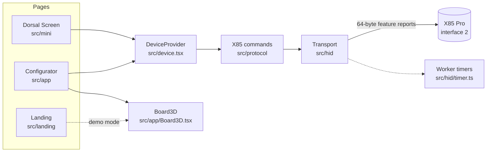

# Architecture

Dorsal is one web application with two entry points, packaged by Electron for the desktop:

- **`index.html`** — the site: the landing page and the configurator, chosen by the route.
- **`mini.html`** — Dorsal Screen, the mini app for the TFT ([details](dorsal-screen.md)).

## Routes

`src/router.ts` reads the path, so the same URLs work on the web and in the AppImages.

| Portuguese | English | Page |
| --- | --- | --- |
| `/` | `/en` | Landing page |
| `/app/tela`, `/app/teclas`, `/app/iluminacao`, `/app/sistema` | `/en/app/screen`, `/keys`, `/lighting`, `/system` | Configurator |
| `/app/log` | `/en/app/log` | Packet log (developer mode only) |
| `/mini.html` | `/mini.html?lang=en` | Dorsal Screen |

Navigation uses the History API. Switching language crossfades with the View Transitions API and keeps the scroll position; moving between pages crossfades and starts at the top.

## Device layer

`src/device.tsx` owns the connection.

- **Connecting**: `navigator.hid.requestDevice` filtered to the cable (`3151:5002`) on the configuration collection (usage page `0xFFFF`, usage `2`). The 2.4G dongle (`3151:5006`) exposes the same collection but answers every configuration command with zeros, so it is never offered. A cable granted before reconnects on its own; a device appearing while one is connected does not reset the connection.
- **Snapshot**: on connect, every setting is read once (key maps, lights, polling, debounce, sleep, screen info, profile, power saving) and cached. The UI reads the cache; writes update it. The mini app reads nothing (`parts={[]}`).
- **Actions**: `useAction` runs a write and reports a short status.
- **Backups** (`src/backup.ts`): restoring reads the keyboard fresh, compares it with the file and lists what will change before writing only the differences. A backup from another keyboard (firmware ID) is refused, and malformed parts of a file are left out.
- **Dry run and log**: in developer mode, writes are logged instead of sent, and the last 400 packets are kept for the Log section.
- **Demo mode**: `?demo` swaps the transport for `src/demo/DemoTransport.ts`, which answers with a capture of a real X85 Pro.

## Protocol

`src/protocol/x85.ts` holds the commands; [`protocol.md`](protocol.md) documents them. Key values are four bytes `[type, a, b, c]` (`src/protocol/keycodes.ts`): HID usages with modifiers, media and system keys, mouse buttons, macros, the Fn key, lighting and connection functions, and the screen functions on the knob column.

## Transport

`src/hid/transport.ts` serialises every exchange: the keyboard stages one reply at a time, so two commands must never interleave.

- **Batches** (a screen upload) hold the queue for their whole length and a Web Lock, so the browser does not freeze or discard the tab halfway.
- **Waits** between packets run in a dedicated worker (`src/hid/timer.ts`). Browsers clamp main-thread timers in hidden tabs to about one per second; measured, 100 waits of 1 ms took 97 s in a hidden window, against 0.34 s for 300 waits in the worker.

## Screen pipeline

| Step | File |
| --- | --- |
| Load a still image, or a GIF composited frame by frame (honouring disposal 2 and 3), up to 60 frames | `src/screen/load.ts` |
| Frame it: fill, fit or stretch, with zoom and pan | `src/screen/load.ts` |
| Convert to RGB565 big-endian, column by column, inside the bounding box of non-black pixels | `src/screen/convert.ts` |
| Build the packets: an `0xA5` handshake, then `0x25` chunks of 56 bytes | `src/screen/packets.ts` |
| Send, report progress, remember the last upload | `src/screen/send.ts`, `uploadJob.ts`, `lastUpload.ts` |
| Editor state shared by the configurator and the mini app | `src/screen/useScreenEditor.ts` |

With nothing chosen, the TFT preview shows the last image sent (kept in `localStorage`, at most 40 frames) or, before any upload, the keyboard's own clock face (`src/screen/clockFace.ts`).

## The 3D board

`src/app/Board3D.tsx` builds the X85 Pro from the physical layout (`src/layout/x85.ts`) with three.js.

- **Model**: sculpted keycaps with a per-row height and tilt, switches, the grey-gradient colourway of the product photo, a turned knob, the TFT showing a live canvas, the USB-C port and switches on the back edge, and the 2.4G dongle.
- **Cost**: caps are instanced by width, switches and glows are one instanced mesh each, and every legend sits in one merged mesh over a texture atlas: about 20 draw calls instead of 300. There are no real-time shadow maps; the contact shadow is painted once.
- **Rendering on demand**: frames are drawn only while something moves (camera, pointer, light effects, a key lifting), and a few times a second otherwise for the TFT clock. The pixel ratio drops when frames take longer than 40 ms.
- **Camera**: each section has a framing (target, direction, lens, and the area that must fit). The distance follows from the stage's aspect, so the subject stays centred in any window. Changing section orbits the camera in 1.1 s, easing in and out.
- **Lighting preview**: each of the 21 key effects and 5 side-light effects has its own motion (`lightAt`), coloured per key and along a LED ring that follows the case outline.

## Languages

Texts are written in place as `tr("Português", "English")` (`src/i18n/index.ts`). Names that come from the protocol tables (keys, functions, light effects, the knob column) are translated in `src/i18n/labels.ts`.

## Desktop shell

`electron/main.cjs` serves `dist/` from `app://x85/`, a privileged scheme that behaves like HTTPS, so WebHID works and the site's routes resolve to `index.html`. It grants HID access only to vendor `0x3151`, prefers the cable, uses the GPU even when Chromium blocklists the driver, and keeps background windows from being throttled. `electron/mini.cjs` opens the same shell on the mini app.
