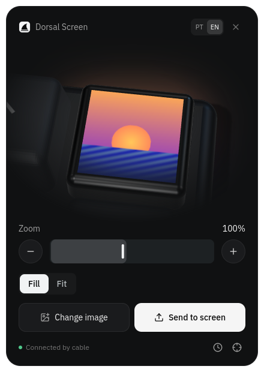

# Dorsal Screen

Dorsal Screen is a small window that only does one thing: put an image or a GIF on the X85 Pro's 0.85" TFT. It is for when you want to change the picture without opening the full configurator.

## Opening it

| Where | How |
| --- | --- |
| AppImage | `release-mini/Dorsal-Screen-<version>.AppImage` (built with `npm run appimage:mini`) |
| Browser | [`dorsal.cotoo.dev/mini.html`](https://dorsal.cotoo.dev/mini.html), in Chrome, Edge, Chromium or Brave |
| Language | The system's; `?lang=en` or `?lang=pt` in the browser, `X85_LANG=en` or `X85_LANG=pt` in the AppImage |
| Without a keyboard | `?demo` in the browser, or `X85_DEMO=1` for the AppImage |

The AppImage opens a frameless, transparent 440 × 620 window; drag it by its top bar. The keyboard is found by itself when it is plugged in by cable.

## Using it

- **Choose an image**, or drop a file anywhere on the window: PNG, JPEG, WebP, BMP or GIF (up to 60 frames).
- **Frame it** on the 3D screen: drag to move, scroll to zoom, or use the slider and the − and + buttons. **Fill** covers the screen; **Fit** shows the whole image.
- **Frame interval**: for GIFs, how long each frame stays (up to 255 ms; it starts at the GIF's own pace).
- **Send to screen**: the button fills as the upload goes, and keeps going with the window in the background.
- In the footer, **set the clock** syncs the keyboard's clock with the computer's, and **center** resets the framing.

Before you choose anything, the 3D screen shows the last image you sent, or the keyboard's clock face if you have not sent one yet. The last image is remembered per address: the browser and the AppImage keep their own.

## How it relates to the configurator

Dorsal Screen and the configurator's **Screen** section share the same code (`src/screen/useScreenEditor.ts`), so they frame and send images the same way. The mini app connects without reading the keyboard's other settings, which is why it opens faster.

| Piece | File |
| --- | --- |
| Window and controls | `src/mini/MiniApp.tsx` |
| 3D close-up of the screen | `src/mini/Screen3D.tsx` |
| Entry and language | `src/mini/main.tsx`, `mini.html` |
| AppImage | `electron/mini.cjs`, `electron-builder.mini.json` |

## Limits

- Images only go over the **USB cable**; the firmware refuses them over the 2.4G dongle.
- The TFT is 128 × 128. Larger images are scaled; GIFs with more than 60 frames are sampled down.
